# Практическая работа: Kafka в production и интеграция с Apache NiFi

Kafka-кластер я развернул **локально в Docker Compose** и приблизил к production-конфигурации:
3 брокера в режиме KRaft, RF=3, `min.insync.replicas=2`, Schema Registry, Avro-сериализация.
Для задания 2 я выбрал **Apache NiFi**.

## Почему не Yandex Cloud

В задании предлагается выполнить работу в Yandex Cloud на стартовом гранте. Я выполнил её локально по следующим причинам.

1. **Не удалось привязать банковскую карту.** Стартовый грант активируется только после создания платёжного аккаунта
   с привязанной картой. Привязать карту у меня не получилось, поэтому грант не активировался и создать кластер
   Managed Service for Apache Kafka® было невозможно.
2. **Риск ухода баланса в минус.** Тарификация посекундная (об этом предупреждает и само задание). Кластер из 3 брокеров
   плюс отдельная ВМ под NiFi расходуют грант быстро, а любая забытая остановка ресурсов превращается в долг.
   Локальный стенд не стоит ничего и может работать сколько угодно долго — во время отладки потока NiFi это было важно.
3. **Воспроизводимость для ревьюера.** Весь стенд поднимается одной командой `./start.sh` на любой машине с Docker:
   ревьюер может сам запустить кластер и повторить все проверки, не имея доступа к моему облаку.

### Соответствие локального стенда Yandex Cloud

Конфигурация повторяет то, что требуется от кластера в облаке, поэтому перенос сводится к замене адресов подключения:

| Требование задания | Yandex Cloud (Managed Kafka) | В этой работе |
|---|---|---|
| 3 брокера | 3 хоста Kafka в разных зонах доступности | 3 брокера `kafka1..3` (KRaft) |
| Аппаратные ресурсы | класс хостов (vCPU/RAM) + тип и размер диска | лимиты CPU/RAM в `docker-compose.yml`, отдельный volume на брокер |
| Топик 3 партиции, RF=3, политика хранения | создание топика в консоли/CLI с настройками | `scripts/create-topics.sh` + `configs/topic-configs.txt` |
| Schema Registry | встроенный реестр схем Managed Kafka | Confluent Schema Registry в Docker |
| Продюсер/консьюмер | подключение по `SASL_SSL` с сертификатом Yandex Cloud | те же клиенты, `PLAINTEXT` (адреса и протокол — через переменные окружения) |
| NiFi | отдельная ВМ в той же сети | контейнер `nifi` в той же Docker-сети |

Для переноса в облако в код нужно добавить только параметры безопасности (`security.protocol=SASL_SSL`,
`sasl.mechanism=SCRAM-SHA-512`, логин/пароль пользователя кластера, путь к CA-сертификату) — логика продюсера,
консьюмера, схема и поток NiFi остаются без изменений.

## Быстрый старт (одной командой)

Для запуска необходимы Docker Compose v2, Python 3.10+ и bash (Linux/macOS или Git Bash на Windows). Весь стенд поднимается одной командой:

```bash
./start.sh
```

Скрипт:
1. создаёт `.env` из `.env.example`;
2. поднимает кластер и ждёт готовности брокеров (`docker compose up -d --wait`);
3. создаёт топики;
4. регистрирует схему;
5. ставит Python-зависимости;
6. создаёт и запускает поток в NiFi.

Повторный запуск безопасен: топики создаются с `--if-not-exists`, поток NiFi пересоздаётся.

> В примерах ниже я использую `python`. В Linux/macOS вместо него может понадобиться `python3`.
> Если скрипт не запускается из-за прав (`Permission denied`), необходимо выполнить `chmod +x start.sh scripts/*.sh` или запустить так: `bash start.sh`.

## Структура проекта

```
.
├── start.sh                    # точка входа: подъём всего стенда одной командой
├── docker-compose.yml          # Kafka x3 (KRaft), Schema Registry, Kafka UI, NiFi
├── .env.example                # учётные данные NiFi (копируется в .env, .env не коммитится)
├── requirements.txt            # Python-зависимости
├── configs/
│   └── topic-configs.txt       # параметры топиков (единый источник для скриптов)
├── schema/
│   └── user.avsc               # Avro-схема данных
├── scripts/
│   ├── common.sh               # общие переменные и функции (подключается остальными)
│   ├── create-topics.sh        # создание топиков student-topic и nifi-users-json
│   ├── configure-topic.sh      # применение параметров к существующему топику
│   ├── describe-topic.sh       # kafka-topics --describe        -> evidence/
│   ├── register-schema.sh      # регистрация схемы + curl /subjects, /versions -> evidence/
│   ├── console-consumers.sh    # kafka-(avro-)console-consumer  -> evidence/
│   └── nifi-check.sh           # статус потока, логи NiFi, файлы -> evidence/
├── app/
│   ├── config.py               # общие настройки клиентов и логирования
│   ├── producer.py             # Avro-продюсер (confluent-kafka + Schema Registry)
│   └── consumer.py             # Avro-консьюмер
├── nifi/
│   ├── setup_flow.py           # создание/запуск/экспорт потока NiFi через REST API
│   ├── flow-definition.json    # экспорт потока (появляется после setup)
│   └── output/                 # сюда NiFi (PutFile) пишет полученные данные
├── logs/                       # логи продюсера и консьюмера (создаются при запуске)
├── evidence/                   # текстовые выводы команд для отчёта
└── screenshots/                # скриншоты для отчёта
```

---

# Задание 1. Развёртывание и настройка Kafka-кластера

## Шаг 1. Развёртывание Kafka

```bash
cp .env.example .env            # если start.sh не используется
docker compose up -d --wait
docker compose ps               # брокеры в статусе (healthy)
```

Все 6 контейнеров запущены, healthcheck пройден:

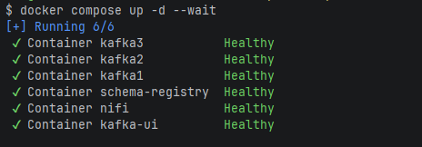

### Аппаратные ресурсы

| Сервис | CPU | RAM (лимит) | JVM heap | Диск |
|---|---|---|---|---|
| kafka1, kafka2, kafka3 | 1 vCPU | 1.5 GiB | 1 GiB (`-Xms1g -Xmx1g`) | отдельный volume `kafkaN-data` на брокер |
| schema-registry | 0.5 vCPU | 512 MiB | 384 MiB | — |
| kafka-ui | 0.5 vCPU | 512 MiB | — | — |
| nifi | 2 vCPU | 2 GiB | 1 GiB | bind-mount `./nifi/output` |
| **Итого** | **6 vCPU** | **~7.5 GiB** | | |

Обоснование:
- Kafka хранит «горячие» данные в page cache ОС, поэтому heap небольшой (1 GiB), а остаток лимита контейнера уходит под кэш файловой системы.
- У каждого брокера свой диск (volume): данные реплик разнесены и сохраняются при пересоздании контейнеров.
- Для реального production рекомендуется: 3 брокера в разных зонах доступности, 2–4 vCPU и 8–16 GB RAM на брокер (heap 4–6 GB), SSD-диски. Объём диска = входящий поток × retention × RF + запас 30–40 %.

### Параметры кластера

| Параметр | Значение | Назначение |
|---|---|---|
| Режим | KRaft, 3 узла `broker,controller` | без ZooKeeper, кворум контроллеров из 3 узлов |
| `default.replication.factor` | 3 | RF по умолчанию для новых топиков |
| `min.insync.replicas` | 2 | с `acks=all` запись подтверждают минимум 2 реплики: кластер переживает отказ 1 брокера без остановки записи и без потери данных |
| `num.partitions` | 3 | партиций по умолчанию |
| `offsets.topic.replication.factor` | 3 | надёжное хранение оффсетов консьюмеров |
| `transaction.state.log.replication.factor` / `min.isr` | 3 / 2 | надёжность транзакций |
| `unclean.leader.election.enable` | false | отстающая реплика не станет лидером (нет потери данных) |
| `auto.create.topics.enable` | false | топики создаются только явно |
| `log.cleanup.policy` | delete | политика очистки по умолчанию |
| `log.retention.ms` | 604800000 (7 дней) | время хранения по умолчанию |
| `log.segment.bytes` | 1073741824 (1 GiB) | размер сегмента по умолчанию |
| `log.retention.check.interval.ms` | 300000 (5 мин) | частота проверки retention |

Адреса:

| Что | Снаружи (хост) | Внутри сети Docker |
|---|---|---|
| Брокеры | `localhost:9092`, `localhost:9094`, `localhost:9095` | `kafka1:29092`, `kafka2:29092`, `kafka3:29092` |
| Schema Registry | http://localhost:8081 | http://schema-registry:8081 |
| Kafka UI | http://localhost:8080 | — |
| NiFi | https://localhost:8443/nifi | — |

Python-клиенты по умолчанию подключаются ко **всем трём** брокерам. Адреса совпадают с `docker-compose.yml` и переопределяются переменными `KAFKA_BOOTSTRAP`, `SCHEMA_REGISTRY_URL`, `KAFKA_TOPIC`.

## Шаг 2. Репликация и хранение данных

Для создания и проверки топиков необходимо выполнить:

```bash
scripts/create-topics.sh     # student-topic и nifi-users-json: 3 партиции, RF=3 + параметры хранения
scripts/configure-topic.sh   # (при необходимости) изменить параметры уже созданного топика
scripts/describe-topic.sh    # вывод kafka-topics --describe -> evidence/topic-describe.txt
```

Параметры топика `student-topic` (см. `configs/topic-configs.txt`):

| Параметр | Значение |
|---|---|
| partitions | 3 |
| replication-factor | 3 |
| cleanup.policy | delete |
| retention.ms | 604800000 (7 дней) |
| segment.bytes | 1073741824 (1 GiB) |
| min.insync.replicas | 2 |

> `log.cleanup.policy`, `log.retention.ms` и `log.segment.bytes` — настройки брокера. Они заданы в `docker-compose.yml` и действуют для всех топиков по умолчанию.
> `cleanup.policy`, `retention.ms` и `segment.bytes` — их аналоги на уровне топика, они имеют приоритет над брокерными.

Создание топиков и применение параметров (`kafka-configs` показывает, что значения уровня топика заданы явно — `DYNAMIC_TOPIC_CONFIG`):

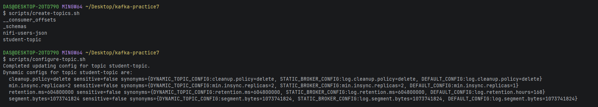

### Вывод `kafka-topics --describe`

> В образах Confluent утилиты называются без `.sh`: `kafka-topics` — это тот же `kafka-topics.sh` из задания.

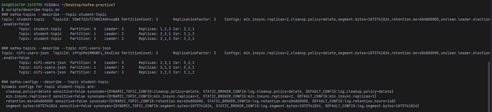

```
### kafka-topics --describe --topic student-topic
Topic: student-topic	TopicId: YDwE722uTZS8GIAHhvxaBA	PartitionCount: 3	ReplicationFactor: 3	Configs: min.insync.replicas=2,cleanup.policy=delete,segment.bytes=1073741824,retention.ms=604800000,unclean.leader.election.enable=false
	Topic: student-topic	Partition: 0	Leader: 3	Replicas: 1,2,3	Isr: 3,2,1
	Topic: student-topic	Partition: 1	Leader: 3	Replicas: 2,3,1	Isr: 3,1,2
	Topic: student-topic	Partition: 2	Leader: 3	Replicas: 3,1,2	Isr: 3,2,1

### kafka-topics --describe --topic nifi-users-json
Topic: nifi-users-json	TopicId: zfFqSPmiRNKWFi_SKvELkA	PartitionCount: 3	ReplicationFactor: 3	Configs: min.insync.replicas=2,cleanup.policy=delete,segment.bytes=1073741824,retention.ms=604800000,unclean.leader.election.enable=false
	Topic: nifi-users-json	Partition: 0	Leader: 3	Replicas: 2,3,1	Isr: 3,2,1
	Topic: nifi-users-json	Partition: 1	Leader: 3	Replicas: 3,1,2	Isr: 3,2,1
	Topic: nifi-users-json	Partition: 2	Leader: 3	Replicas: 1,2,3	Isr: 3,1,2
```

Что видно из вывода:
- у каждого топика 3 партиции и `ReplicationFactor: 3`, реплики распределены по всем трём брокерам (1, 2, 3);
- `Isr` содержит все 3 реплики: все реплики синхронны, данные не отстают;
- параметры хранения (`cleanup.policy`, `retention.ms`, `segment.bytes`, `min.insync.replicas`) применены к топикам.

> Все лидеры сейчас на брокере 3 (так бывает, если брокеры стартовали не одновременно). На работу это не влияет. Чтобы распределить лидеров равномерно, можно выполнить
> `docker exec kafka1 kafka-leader-election --bootstrap-server kafka1:29092 --election-type preferred --all-topic-partitions`.

## Шаг 3. Schema Registry

Schema Registry я развернул в `docker-compose.yml` (сервис `schema-registry`). Схемы он хранит в топике `_schemas` с RF=3.

Схема — `schema/user.avsc`: Avro-запись `ru.practice.kafka.User` с полями `id`, `name`, `email` (nullable) и `created_at`.
Она регистрируется в subject `student-topic-value`. Это имя по TopicNameStrategy, и именно его ищут сериализаторы для топика `student-topic`. Режим совместимости — `BACKWARD`.

Для регистрации схемы и проверки необходимо выполнить:

```bash
scripts/register-schema.sh
curl http://localhost:8081/subjects
curl -X GET http://localhost:8081/subjects/student-topic-value/versions
```

Результат: схема зарегистрирована с `id=1`, subject `student-topic-value`, версия `[1]`, совместимость `BACKWARD`:

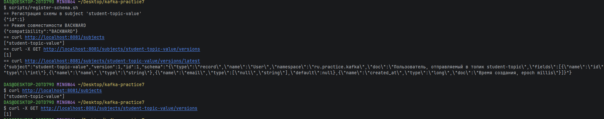

```
$ curl http://localhost:8081/subjects
["student-topic-value"]
$ curl -X GET http://localhost:8081/subjects/student-topic-value/versions
[1]
```

## Шаг 4. Проверка работы Kafka

Для проверки необходимо установить зависимости и запустить консьюмер и продюсер в двух терминалах:

```bash
python -m pip install -r requirements.txt
python app/consumer.py --idle-timeout 20   # терминал 1
python app/producer.py --count 10          # терминал 2
```

**Продюсер** (`app/producer.py`):
- сериализует сообщения в Avro по схеме из Schema Registry. `auto.register.schemas=false`: используется только заранее зарегистрированная схема;
- `acks=all` и `enable.idempotence=true`; ключ сообщения — `id` пользователя;
- логирует партицию и оффсет каждого доставленного сообщения;
- обрабатывает ошибки сериализации, переполнение буфера и ошибки доставки. Если что-то не доставлено, завершается с кодом 1.

**Консьюмер** (`app/consumer.py`):
- группа `practice-group`, `auto.offset.reset=earliest`, автокоммит выключен. Оффсет коммитится вручную после обработки каждого сообщения, поэтому повторный запуск продолжает с места остановки, а не читает топик заново;
- десериализует Avro по id схемы из заголовка сообщения;
- **битые сообщения не роняют консьюмер**: ошибка логируется, сообщение пропускается, его оффсет коммитится, чтобы не зациклиться.

Логи дублируются в `logs/producer.log` и `logs/consumer.log`.

Логи продюсера (успешная отправка 10 сообщений, у каждого — партиция и оффсет):

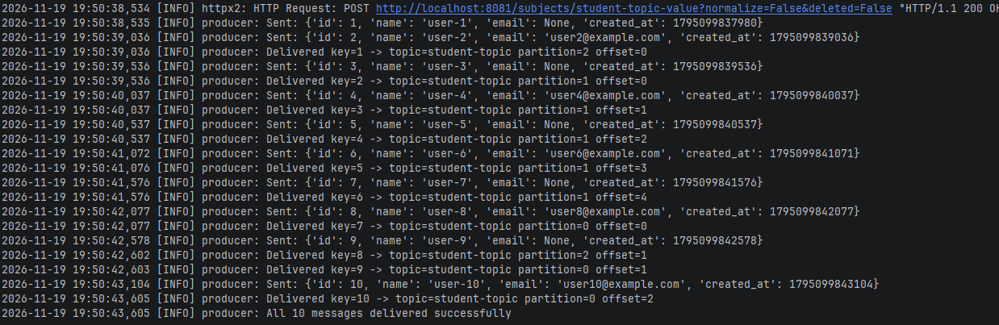

Логи консьюмера (успешное чтение): получены все 10 сообщений, партиции и оффсеты совпадают с логом продюсера
(например, `key=1 -> partition=2 offset=0`, `key=7 -> partition=0 offset=0`):

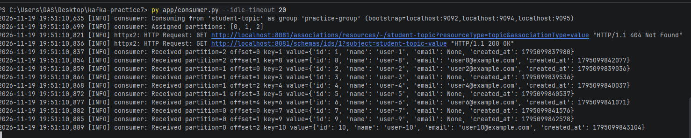

### Проверка обработки ошибок

Для проверки необходимо отправить в топик битые сообщения:

```bash
python app/producer.py --count 3 --start-id 100 --bad 2   # 3 корректных + 2 битых (не-Avro) сообщения
```

Консьюмер выведет `Skipping bad message ...` и продолжит работу. NiFi отправит битые сообщения в `nifi/output/failed/`.

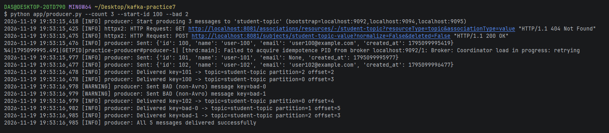

> Предупреждение `Failed to acquire idempotence PID ... Coordinator load in progress: retrying` — временное:
> координатор транзакций ещё загружался. Продюсер сам повторил запрос, все 5 сообщений доставлены.

---

# Задание 2. Интеграция Kafka с Apache NiFi

## Развёртывание

NiFi 1.25.0 запускается тем же `docker-compose.yml` (сервис `nifi`).
- Логин и пароль берутся из `.env` (`NIFI_USERNAME`, `NIFI_PASSWORD`). В репозитории лежит только `.env.example`.
- UI: https://localhost:8443/nifi (сертификат самоподписанный).
- Конфигурационные файлы запуска: `docker-compose.yml` (сервис `nifi`), `.env.example` и `nifi/setup_flow.py` (поток).
- Экспорт потока: `nifi/flow-definition.json`. Его можно импортировать в NiFi через *Upload flow definition*.

```bash
docker compose ps          # запущенные сервисы
```

Контейнер `nifi` в статусе Healthy — см. скриншот в [Шаге 1](#шаг-1-развёртывание-kafka).
Создание потока через `start.sh` / `nifi/setup_flow.py`: 6 controller services, 7 процессоров, 7 связей, все процессоры VALID, группа RUNNING:

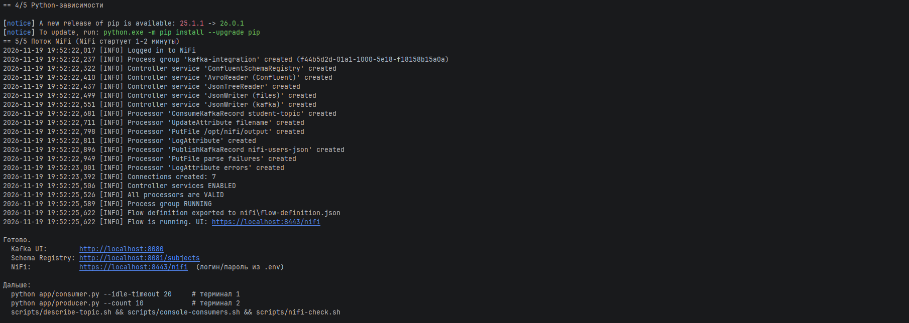

## Поток NiFi

```
ConsumeKafkaRecord_2_6  (student-topic, group nifi-consumer-group,
   │                     AvroReader + ConfluentSchemaRegistry -> JSON)
   │ success
   ├──> UpdateAttribute (filename = users-<время>-<партиция>.json) ──> PutFile (./nifi/output)
   ├──> LogAttribute    (атрибуты и содержимое -> docker logs nifi)
   └──> PublishKafkaRecord_2_6 (nifi-users-json, JSON, acks=all)

   │ parse.failure (не-Avro / неизвестная схема)
   └──> PutFile (./nifi/output/failed)

PutFile failure, PublishKafkaRecord failure ──> LogAttribute (уровень ERROR)
```

NiFi **читает** из Kafka (Avro со Schema Registry), **пишет** обратно в Kafka (JSON) и сохраняет данные в файлы. Ни одна ошибка не отбрасывается молча.

Управление потоком (обычно достаточно `./start.sh`):

```bash
python nifi/setup_flow.py setup            # создать, включить сервисы, запустить, экспортировать
python nifi/setup_flow.py setup --recreate # пересоздать
python nifi/setup_flow.py status           # счётчики In/Out по процессорам и очереди
python nifi/setup_flow.py export           # сохранить nifi/flow-definition.json
```

## Передача данных

Код продюсера и консьюмера — `app/producer.py` и `app/consumer.py` (общие с заданием 1).

```bash
python app/producer.py --count 10 --start-id 11   # продюсер пишет в student-topic
scripts/console-consumers.sh                      # kafka-console-consumer по обоим топикам
scripts/nifi-check.sh                             # статус NiFi, логи, записанные файлы
```

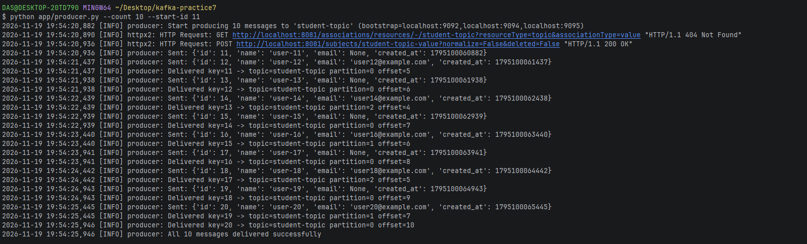

Всего в `student-topic` записано 25 сообщений: 23 корректных (id 1–10, 11–20, 100–102) и 2 битых.

> Время в логах контейнеров (Kafka, NiFi) и в именах файлов NiFi — UTC, в логах Python-клиентов — локальное (UTC+5).
> Поэтому `14:54` в логах NiFi и `19:54` в логах продюсера — один и тот же момент.

### Kafka-топик с поступающими данными (kafka-console-consumer)

- `student-topic` — исходные Avro-сообщения (`kafka-avro-console-consumer`);
- `nifi-users-json` — те же данные в JSON, отправленные NiFi (`kafka-console-consumer`).

`student-topic` (Avro, десериализуется по схеме из Schema Registry). Ошибка `Unknown magic byte!` — это одно из двух
битых (не-Avro) сообщений: консольный консьюмер пропускает его и читает дальше.

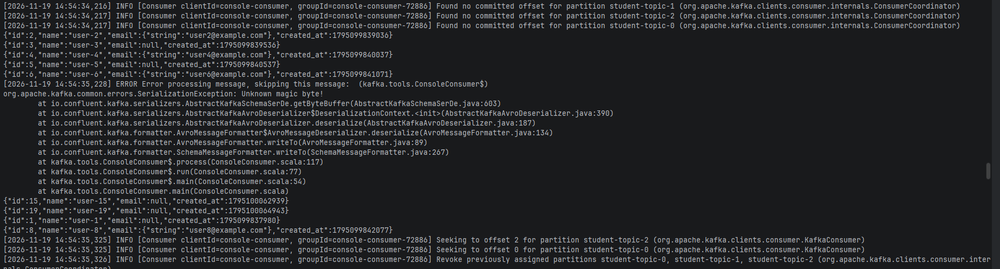

`nifi-users-json` (JSON, записанный NiFi):

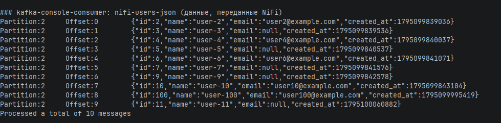

> NiFi публикует записи без ключа, поэтому Kafka-продюсер NiFi кладёт пачку подряд в одну партицию (sticky partitioner).
> Скрипт выводит первые 10 сообщений, поэтому на скриншоте все они из партиции 2.

### Логи успешной работы NiFi

Статус потока: все 7 процессоров RUNNING, очереди пустые (всё обработано).
`ConsumeKafkaRecord` выдал 47 FlowFile = 15 пачек × 3 направления (UpdateAttribute, LogAttribute, PublishKafkaRecord) + 2 битых сообщения в `parse.failure`.
`LogAttribute errors` получил 0 — ошибок записи в файлы и в Kafka нет:

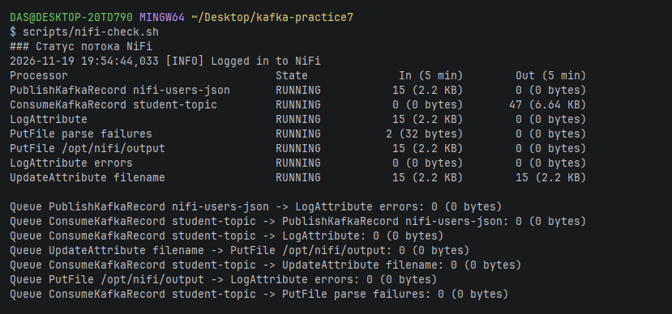

```bash
docker logs nifi 2>&1 | grep -A 20 LogAttribute
```

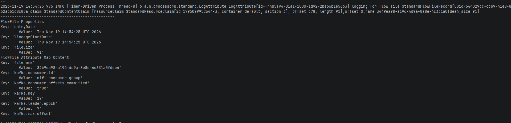

### Подтверждение записи данных (PutFile)

```bash
ls -la nifi/output
cat nifi/output/users-*.json
```

PutFile записал 15 JSON-файлов (имя: `users-<время UTC>-<партиция>.json`), в `failed/` — 2 битых сообщения по 16 байт:

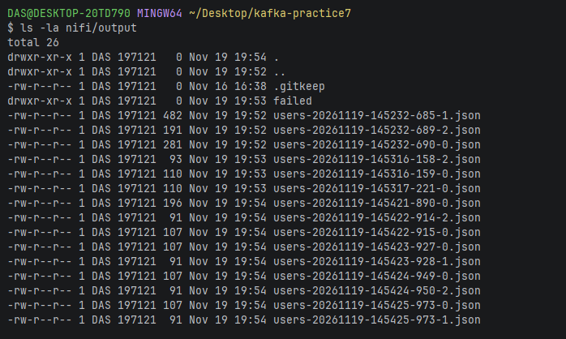

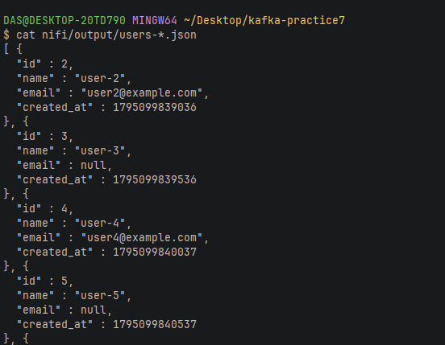

---

## Остановка

```bash
docker compose down        # остановить
docker compose down -v     # остановить и удалить данные брокеров
```

> Поток NiFi хранится внутри контейнера. После `docker compose down` необходимо ещё раз запустить `./start.sh`: поток будет создан заново.
